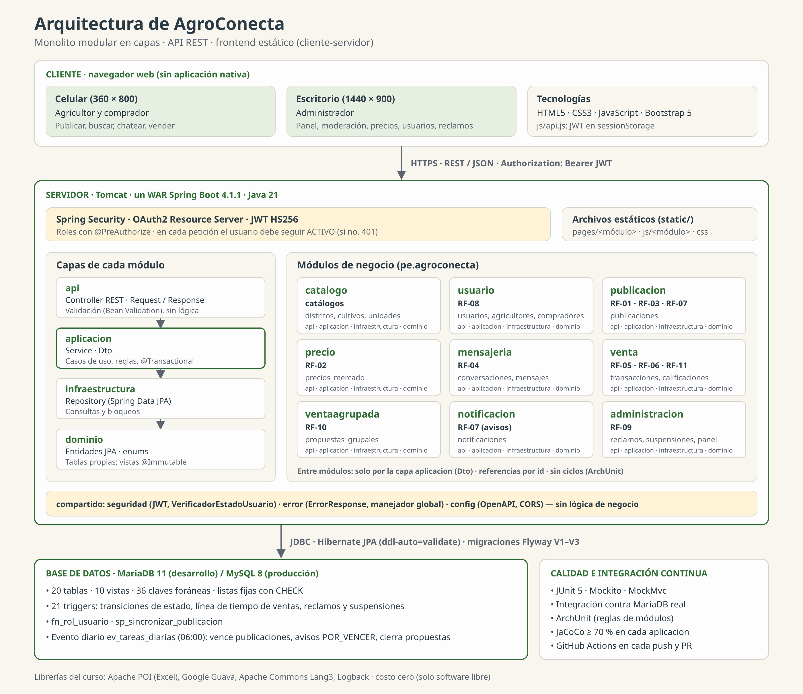
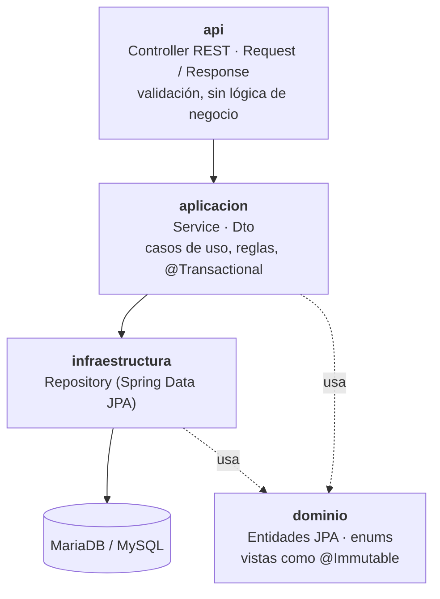
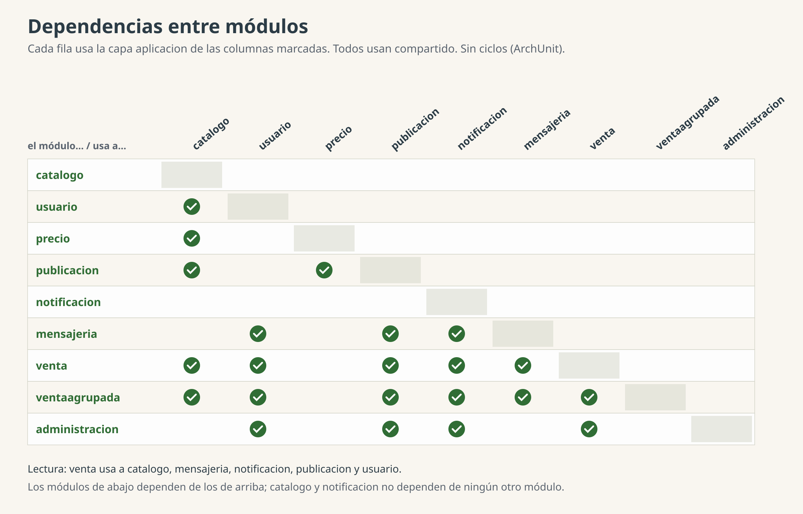
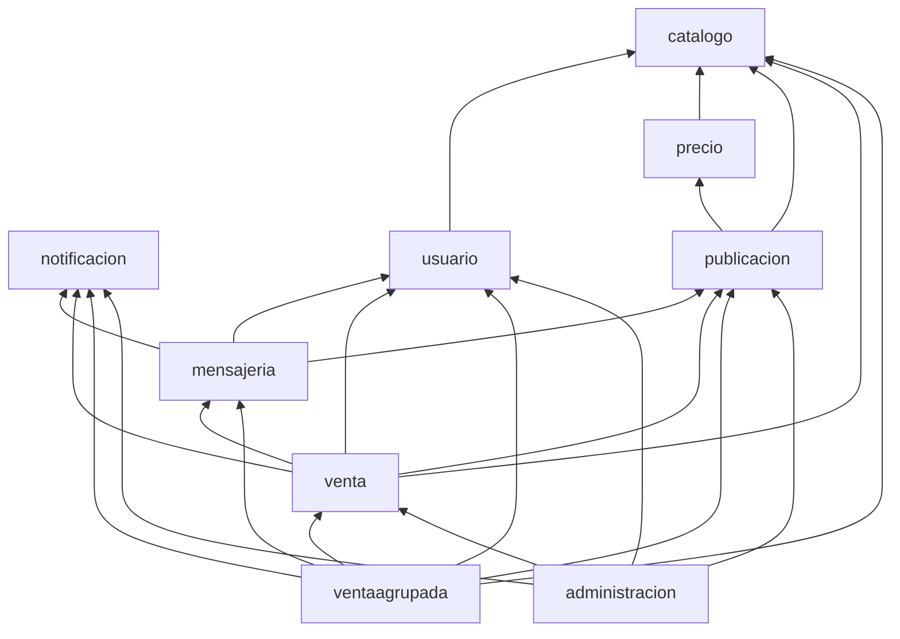
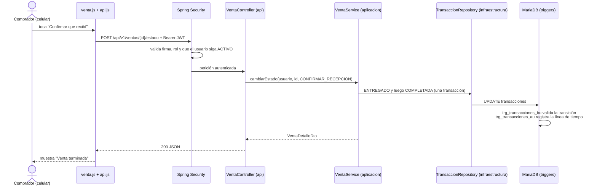

# Arquitectura de AgroConecta

AgroConecta es un **monolito modular con arquitectura en capas**: una sola aplicación web (un WAR de Spring Boot) dividida en módulos de negocio, con una **API REST** y un **frontend estático** que la consume (cliente-servidor). Las decisiones de fondo están en [ADR-001](../../06-decisiones/ADR-001-monolito-modular.md) (monolito modular), [ADR-003](../../06-decisiones/ADR-003-jwt-con-oauth2-resource-server.md) (JWT) y [ADR-004](../../06-decisiones/ADR-004-esquema-sql-con-flyway.md) (esquema SQL con Flyway).

Archivos de este directorio:

| Archivo | Uso |
|---|---|
| `arquitectura-general.svg` / `.png` | Vista general: cliente, servidor (seguridad, capas, módulos) y base de datos |
| `dependencias-modulos.svg` / `.png` | Matriz de dependencias entre módulos |

Los `.svg` se editan con cualquier editor de SVG (por ejemplo, Inkscape o draw.io). Los `.png` (a doble resolución, para el informe) se regeneran con `rsvg-convert -z 2 -o archivo.png archivo.svg`.

## 1. Vista general

| Parte | Tecnología | Responsabilidad |
|---|---|---|
| Cliente | HTML5, CSS3, JavaScript sin frameworks, Bootstrap 5 local | Pantallas de celular (agricultor, comprador) y de escritorio (administrador). `js/api.js` envía el JWT y muestra los errores de la API |
| Seguridad | Spring Security, OAuth2 Resource Server, JWT HS256, BCrypt | Ingreso con celular y contraseña; roles con `@PreAuthorize`; en cada petición el usuario debe seguir ACTIVO |
| Módulos de negocio | Spring Boot 4.1.1, Java 21 | Casos de uso de RF-01 a RF-11, uno o varios por módulo |
| `compartido` | — | Seguridad, formato único de errores (`ErrorResponse`) y configuración; sin lógica de negocio |
| Base de datos | MariaDB 11 (desarrollo) / MySQL 8 (producción), Flyway | Tablas, vistas, triggers, función, procedimiento y evento diario: la última barrera de las reglas de negocio |
| Calidad | JUnit 5, Mockito, MockMvc, ArchUnit, JaCoCo, GitHub Actions | Pruebas unitarias y de integración contra MariaDB real, reglas de arquitectura y cobertura ≥ 70 % en cada capa `aplicacion` |

## 2. Capas de cada módulo

Todos los módulos (`pe.agroconecta.<modulo>`) tienen las mismas cuatro capas. Dentro de un módulo se puede describir como el patrón **Controller–Service–Repository** de Spring.

| Capa | Contiene | Regla |
|---|---|---|
| `api` | `XxxController`, `XxxRequest`, `XxxResponse` (records) | Solo recibe, valida y responde Dto; nunca entidades |
| `aplicacion` | `XxxService`, `XxxDto` (records) | Toda regla de negocio; mensajes en español; `ReglaNegocioException` → 422 |
| `infraestructura` | `XxxRepository extends JpaRepository` | Solo la usa la capa `aplicacion` de su propio módulo |
| `dominio` | Entidades JPA y enums de los `CHECK` | Solo las tablas y vistas propias del módulo |

## 3. Módulos y sus tablas

| Módulo | Requisitos | Tablas y vistas propias |
|---|---|---|
| `catalogo` | catálogos compartidos | provincias, distritos, cultivos, variedades, unidades_medida |
| `usuario` | RF-08 | usuarios, agricultores, compradores |
| `publicacion` | RF-01, RF-03, RF-07 (acciones rápidas) | publicaciones, v_publicaciones_disponibles |
| `precio` | RF-02 | precios_mercado, v_precios_vigentes, v_rango_precio_plataforma |
| `mensajeria` | RF-04 | conversaciones, mensajes |
| `venta` | RF-05, RF-06, RF-11 | transacciones, transacciones_historial, calificaciones, v_historial_transacciones, v_reputacion_usuario |
| `ventaagrupada` | RF-10 | propuestas_grupales, v_lotes_agrupados |
| `notificacion` | RF-07 (avisos) | notificaciones |
| `administracion` | RF-09 | revisiones_publicacion, reclamos, suspensiones, v_panel_admin, v_resumen_usuario, v_ventas_mensuales_cultivo, v_conversion_publicacion |

## 4. Dependencias entre módulos

Reglas verificadas con ArchUnit en `ArquitecturaTest`:

1. Un módulo usa a otro **solo por la capa `aplicacion`** de ese otro, que devuelve Dto (nunca entidades).
2. Los repositorios solo los usa la capa `aplicacion` de su propio módulo.
3. Los controladores dependen de `aplicacion`, nunca de `infraestructura`.
4. `compartido` no depende de ningún módulo; define interfaces (como `VerificadorEstadoUsuario`) que los módulos implementan.
5. No hay ciclos entre módulos.

Además, una entidad nunca referencia con `@ManyToOne` a la de otro módulo: guarda su id (`Long idAgricultor`). Las claves foráneas siguen existiendo en la base de datos.

## 5. Flujo de una petición

Ejemplo: el comprador confirma que recibió su compra ("Confirmar que recibí", RF-11).

Si una regla falla, el servicio responde con un mensaje en español (422); si la base de datos la rechaza, `ManejadorGlobalExcepciones` convierte el error al mismo formato `ErrorResponse`, sin mostrar detalles de SQL.

## 6. Reglas de negocio en la base de datos

Muchas reglas viven en la base de datos y Java no las repite como efectos (solo las valida antes para dar mensajes amigables):

- **Triggers (21):** transiciones de estado de publicaciones y ventas, línea de tiempo de las ventas (`transacciones_historial`), reglas de moderación, reclamos y suspensiones.
- **Procedimiento `sp_sincronizar_publicacion`:** marca la publicación VENDIDA o la devuelve a PUBLICADA según lo acordado.
- **Evento diario `ev_tareas_diarias` (06:00):** vence publicaciones, crea los avisos POR_VENCER y cierra las propuestas conjuntas vencidas. No hay tareas programadas en Java.
- **Migraciones Flyway:** `V1__esquema_inicial.sql`, `V2__datos_iniciales.sql`, `V3__bloqueo_sobre_corregida.sql`; Hibernate solo valida (`ddl-auto=validate`).
