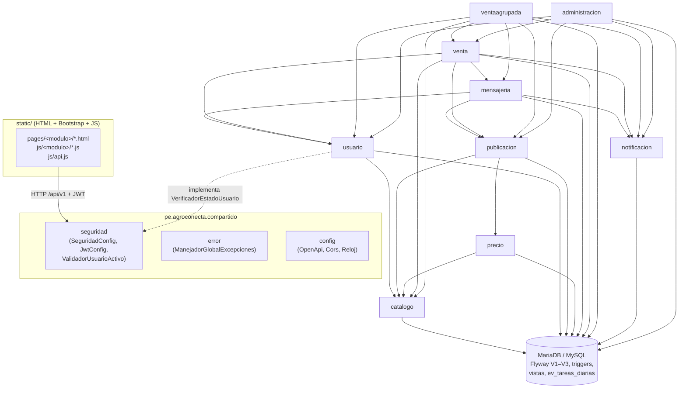
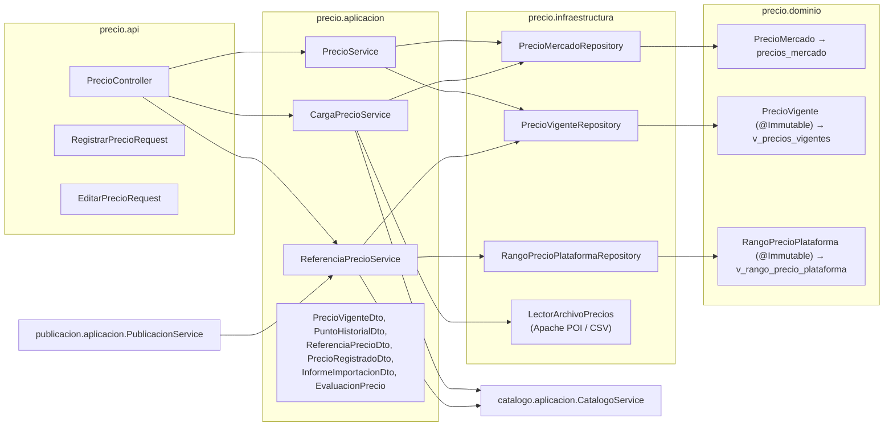
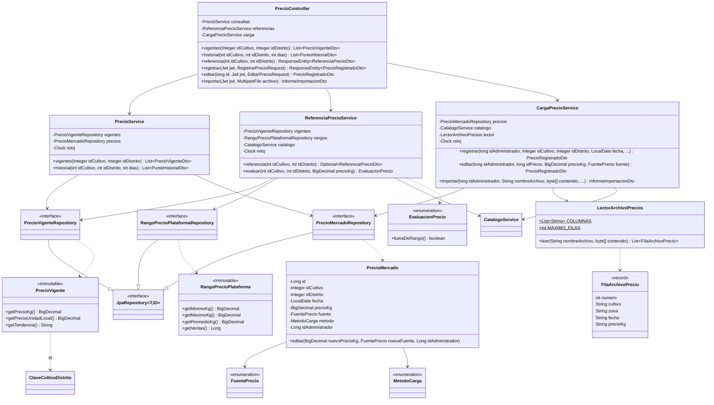

# Diagramas del código (APF3)

Tres diagramas Mermaid obtenidos del código de `src/main/java` en la auditoría del APF3 (24/10/2026; ver `docs/academico/apf3-auditoria.md`, sección 7). Complementan la vista general y la matriz de dependencias de [arquitectura.md](arquitectura.md). Las dependencias entre módulos salen de los `import pe.agroconecta.<modulo>.` reales; el módulo `precio` (RF-02) se usa como ejemplo porque recorre todas las capas, tiene vistas `@Immutable` y usa Apache POI, Guava y Commons Lang3.

GitHub muestra los bloques `mermaid` como diagramas. Para el informe se pueden exportar a PNG o SVG con [Mermaid Live Editor](https://mermaid.live) o con `mmdc` (mermaid-cli).

## 1. Estructura de módulos y paquetes

Cliente estático, `compartido` (seguridad, errores, configuración), los nueve módulos de negocio con sus dependencias (siempre hacia la capa `aplicacion` del otro módulo, verificado por `ArquitecturaTest`) y la base de datos.

## 2. Capas del módulo `precio`

`api` → `aplicacion` → `infraestructura` → base de datos; `dominio` mapea solo las tablas y vistas propias del módulo. `publicacion` usa `ReferenciaPrecioService` para la marca PRECIO_FUERA_RANGO (RF-01).

## 3. Diagrama de clases del módulo `precio`

