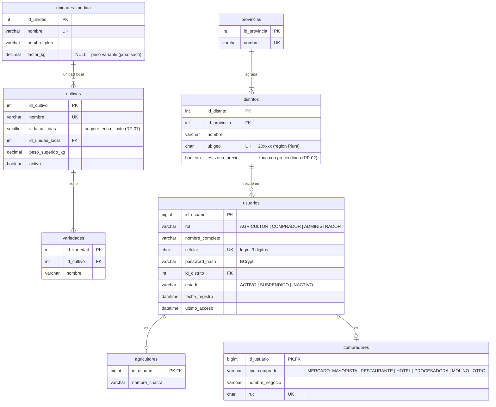
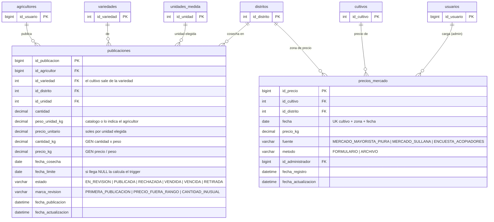
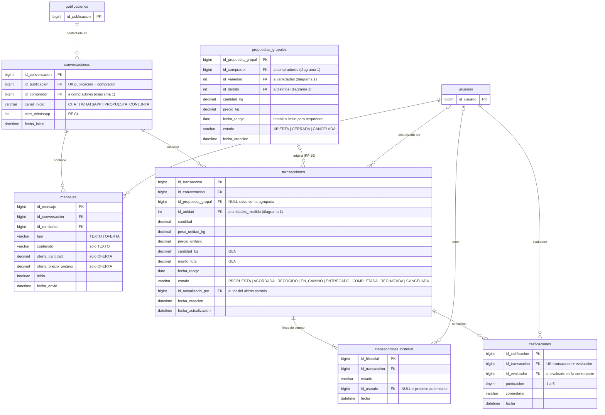

# AgroConecta — Modelo lógico de datos (v4)

**Fuente de verdad:** `modelo-bd.sql` v4. Si este documento y el script difieren, gana el script.
**Cambios respecto a v3:** ver `cambios-v4.md`. **Reglas que el diagrama no expresa:** ver `notas-integridad-bd.md`.

El modelo tiene **20 tablas y 36 claves foráneas**. No se dibuja en una sola hoja: eso producía la "telaraña" observada por el docente (líneas cruzadas y un mismo dato alcanzable por dos rutas). Hay un diagrama por módulo, de 5 a 8 tablas cada uno:

| # | Diagrama | Tablas propias | Tablas de referencia (solo PK) |
|---|---|---|---|
| 1 | Usuarios y catálogos | provincias, distritos, unidades_medida, cultivos, variedades, usuarios, agricultores, compradores | — |
| 2 | Publicación y precios | publicaciones, precios_mercado | usuarios, distritos, cultivos, agricultores, variedades, unidades_medida |
| 3 | Comercial | conversaciones, mensajes, propuestas_grupales, transacciones, transacciones_historial, calificaciones | usuarios, publicaciones |
| 4 | Administración | revisiones_publicacion, reclamos, suspensiones, notificaciones | usuarios, publicaciones, transacciones |

**Convenciones:**

- Las tablas compartidas (`usuarios`, `distritos`, `cultivos`) y las de otros diagramas aparecen **solo con su clave primaria**. Sus atributos completos están en el diagrama donde nacen.
- Cuando dibujar una tabla de referencia superaría las 8 tablas, la FK se muestra como atributo `FK` y se lista en "Referencias a otros diagramas". Todas las FK existen en la base de datos.
- Los estados, roles, motivos, fuentes y tipos son listas fijas con `CHECK` (no son tablas). Sus valores se indican en cada diagrama.
- `GEN` indica una columna generada (`GENERATED ALWAYS AS ... STORED`). Se calcula en la BD y en JPA se mapea como solo lectura.

---

## 1. Usuarios y catálogos (RF-08; catálogos de RF-01, RF-02, RF-03 y RF-10)

Herencia por tabla de subtipo: `usuarios.rol` indica el rol, y los datos propios viven en `agricultores` o `compradores`. El ADMINISTRADOR no tiene subtipo.

**Vistas del área:** `v_resumen_usuario` (pantalla Usuarios y perfil).

---

## 2. Publicación y precios (RF-01, RF-02, RF-03, RF-07)

**Vistas del área:** `v_publicaciones_disponibles` (búsqueda y "Mis ventas"), `v_precios_vigentes` (precio del día en kilo y en unidad local, con tendencia), `v_rango_precio_plataforma` (rango de ventas completadas en 30 días).

**Ciclo de la publicación** (lo controla `trg_publicaciones_bu`):
EN_REVISION → PUBLICADA | RECHAZADA | RETIRADA · RECHAZADA → EN_REVISION | RETIRADA · PUBLICADA → VENDIDA | VENCIDA | RETIRADA · VENDIDA → PUBLICADA | VENCIDA · VENCIDA → PUBLICADA | RETIRADA.

---

## 3. Comercial (RF-04, RF-05, RF-06, RF-10, RF-11)

Una conversación es "una publicación + un comprador" y es el eje comercial: de ella salen el agricultor (por la publicación) y el comprador. Por eso `transacciones` no apunta directamente a la publicación ni al comprador.

**Referencias a otros diagramas** (FK que existen en la BD y no se dibujan aquí):

| FK | Tabla referenciada | Diagrama |
|---|---|---|
| `conversaciones.id_comprador` | `compradores` | 1 |
| `propuestas_grupales.id_comprador` | `compradores` | 1 |
| `propuestas_grupales.id_variedad` | `variedades` | 1 |
| `propuestas_grupales.id_distrito` | `distritos` | 1 |
| `transacciones.id_unidad` | `unidades_medida` | 1 |

**Vistas del área:** `v_historial_transacciones`, `v_reputacion_usuario`, `v_lotes_agrupados`, `v_conversion_publicacion`.

**Ciclo de la transacción** (lo controlan `trg_transacciones_bi` y `trg_transacciones_bu`; cada cambio queda en `transacciones_historial`):

- Acuerdo del chat: ACORDADA → RECOGIDO → EN_CAMINO → ENTREGADO → COMPLETADA. ACORDADA → CANCELADA.
- Venta agrupada: PROPUESTA → ACORDADA (sigue igual que el chat) | RECHAZADA (agricultor) | CANCELADA (comprador o proceso diario).

---

## 4. Administración (RF-07, RF-09)

```mermaid
erDiagram
    publicaciones ||--o{ revisiones_publicacion : "revisada en"
    usuarios ||--o{ revisiones_publicacion : "administrador"
    transacciones ||--o{ reclamos : "reclamada en"
    usuarios ||--o{ reclamos : "reclamante"
    usuarios |o--o{ reclamos : "resuelve (admin)"
    usuarios ||--o{ suspensiones : "suspendido"
    usuarios ||--o{ suspensiones : "suspende (admin)"
    usuarios ||--o{ notificaciones : "recibe"

    publicaciones {
        bigint id_publicacion PK
    }
    transacciones {
        bigint id_transaccion PK
    }
    usuarios {
        bigint id_usuario PK
    }
    revisiones_publicacion {
        bigint id_revision PK
        bigint id_publicacion FK
        bigint id_administrador FK
        varchar decision "APROBADA | RECHAZADA"
        varchar motivo_rechazo "PRECIO_NO_COINCIDE | CANTIDAD_INCORRECTA | PESO_UNIDAD_INCORRECTO | DATOS_INCORRECTOS | OTRO"
        varchar mensaje "lo ve el agricultor"
        datetime fecha
    }
    reclamos {
        bigint id_reclamo PK
        bigint id_transaccion FK "UK transaccion + reclamante"
        bigint id_reclamante FK "el reclamado es la contraparte"
        varchar motivo "NO_SE_PRESENTO | PRODUCTO_NO_COINCIDE | CANTIDAD_INCOMPLETA | INCUMPLIO_PAGO | MAL_TRATO"
        varchar descripcion
        varchar estado "PENDIENTE | FUNDADO | INFUNDADO"
        bigint id_administrador FK
        varchar respuesta
        datetime fecha_registro
        datetime fecha_resolucion
    }
    suspensiones {
        bigint id_suspension PK
        bigint id_usuario FK
        bigint id_administrador FK
        varchar motivo "RECLAMOS_FUNDADOS | DATOS_FALSOS | PUBLICACIONES_ENGANOSAS | USO_INDEBIDO"
        varchar detalle
        datetime fecha_inicio
        datetime fecha_fin "reactivacion"
    }
    notificaciones {
        bigint id_notificacion PK
        bigint id_usuario FK
        varchar tipo "POR_VENCER | OFERTA | MENSAJE | PUBLICACION_APROBADA | PUBLICACION_RECHAZADA | PROPUESTA_CONJUNTA | VENTA | CALIFICACION | RECLAMO | CUENTA"
        varchar titulo
        varchar contenido
        bigint id_referencia "sin FK a proposito"
        boolean leida
        datetime fecha_creacion
    }
```

`notificaciones.id_referencia` no tiene FK a propósito: según el tipo, apunta a una publicación, una transacción, una conversación o una propuesta grupal.

**Vistas del área:** `v_panel_admin`, `v_ventas_mensuales_cultivo`, `v_resumen_usuario`, `v_conversion_publicacion`.

---

## 5. Comprobación de cobertura

| Diagrama | FK dibujadas | FK listadas como referencia |
|---|---|---|
| 1. Usuarios y catálogos | 6 | 0 |
| 2. Publicación y precios | 7 | 0 |
| 3. Comercial | 10 | 5 |
| 4. Administración | 8 | 0 |
| **Total** | **31** | **5** |

31 + 5 = 36 claves foráneas, las mismas de `modelo-bd.sql`. Cada una de las 20 tablas aparece completa en exactamente un diagrama.
