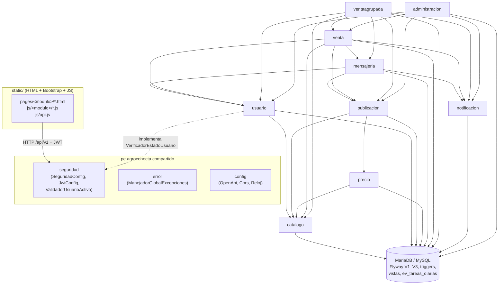
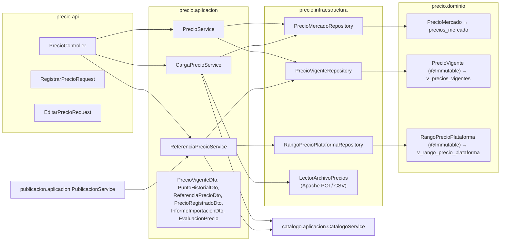
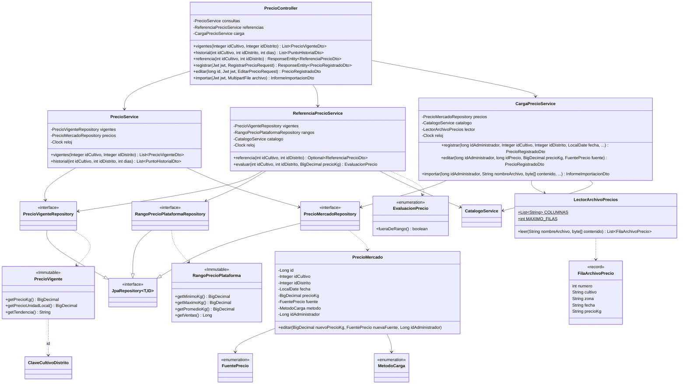

# Auditoría del repositorio para el APF3 (semana 12) — AgroConecta

> **Instantánea del 24/10/2026, anterior a la rama `chore/apf3-cierre`.** Varias brechas de la sección 8 ya se cerraron en esa rama (Logback configurado, límite de intentos de inicio de sesión, Swagger desactivado en `prod`, Javadoc sin advertencias, README, diagramas y documentos de calidad). El estado actual está en [`apf3-evidencias.md`](apf3-evidencias.md) y en [`../07-calidad/`](../07-calidad/).

- **Fecha de la auditoría:** 23/10/2026 (completada el 24/10/2026 con MariaDB activa)
- **Rama auditada:** `feat/ui-inicio` (commit `ed67b40`), con 4 archivos modificados sin confirmar (`LectorArchivoPrecios.java`, `AgroconectaApplicationTests.java`, `UsuarioAdminServiceTest.java`, `BusquedaServiceTest.java`). El diff es **solo de formato** (cortes de línea del editor); no cambia el comportamiento.
- **Modo:** solo lectura. No se modificó, confirmó ni subió nada salvo este archivo. Para compilar y probar se cargaron las variables de `.env` (sin imprimirlas).
- **Ejecuciones:** en la primera pasada (23/10) MariaDB estaba detenido y las 105 pruebas de integración no pudieron conectarse. El 24/10, con MariaDB activo, se repitió `./mvnw -B clean verify` (**238/238 pruebas en verde, BUILD SUCCESS**) y se levantó la aplicación (perfil `dev`) para una prueba de humo de la API **solo con lecturas e inicio de sesión** (no se creó ni modificó ningún dato). Las cifras de este informe son las de la segunda ejecución.

---

## 1. Estado por RF (RF-01 a RF-11)

Notación de pruebas: **U** = unitarias (Mockito), **I** = integración (`@SpringBootTest` + MockMvc contra MariaDB `agroconecta_test`). Los conteos son de métodos de prueba según Surefire (un `@ParameterizedTest` cuenta cada caso).

| RF | Endpoints implementados (método + ruta) | Pantalla(s) y llamada real a la API | Pruebas | Estado |
|---|---|---|---|---|
| **RF-01** Publicar cosecha | `POST /api/v1/publicaciones`, `GET /api/v1/publicaciones/{id}`; catálogos `GET /api/v1/catalogo/{provincias,distritos,cultivos,variedades,unidades}` | `pages/publicacion/paso1..3.html`, `confirmar.html`, `publicada.html` → **Sí** (`js/publicacion/paso1.js`, `paso2.js`, `paso3.js`, `confirmar.js` usan `api.get/post`) | U: `PublicacionServiceTest` (11), `CatalogoServiceTest` (8) · I: `PublicacionIntegracionTest` (13), `CatalogoIntegracionTest` (4) | **Completo** (código y pantallas) |
| **RF-02** Precios de referencia | `GET /api/v1/precios/vigentes`, `GET /api/v1/precios/historial`, `GET /api/v1/precios/referencia`, `POST /api/v1/precios`, `PUT /api/v1/precios/{id}`, `POST /api/v1/precios/archivo` | `index.html` (portada) y `pages/administracion/precios.html` → **Sí** (`js/portada.js`, `js/administracion/precios.js`) | U: `ReferenciaPrecioServiceTest` (4) · I: `PrecioIntegracionTest` (7) | **Completo** (código y pantallas) |
| **RF-03** Búsqueda y filtros | `GET /api/v1/publicaciones` (filtros, orden y paginación) | `pages/publicacion/buscar.html`, `detalle.html` → **Sí** (`js/publicacion/buscar.js`, `detalle.js`) | U: `BusquedaServiceTest` (5) · I: `BusquedaIntegracionTest` (8) | **Completo** |
| **RF-04** Mensajería y ofertas | `POST /api/v1/conversaciones`, `POST /api/v1/conversaciones/whatsapp`, `GET /api/v1/conversaciones`, `GET /api/v1/conversaciones/no-leidos`, `GET /api/v1/conversaciones/{id}`, `GET /api/v1/conversaciones/{id}/mensajes`, `POST /api/v1/conversaciones/{id}/mensajes` | `pages/mensajeria/conversaciones.html`, `chat.html` → **Sí** (`js/mensajeria/*.js`) | U: `ConversacionServiceTest` (6) · I: `MensajeriaIntegracionTest` (8) | **Completo** |
| **RF-05** Calificaciones | `POST /api/v1/ventas/{id}/calificacion`, `GET /api/v1/reputaciones/{idUsuario}` | Dentro de `pages/venta/venta.html`, `publicacion/detalle.html` y `usuario/perfil.html` → **Sí** (`js/venta/venta.js`, `js/venta/reputacion.js`) | U: `CalificacionServiceTest` (4) · I: `CalificacionIntegracionTest` (3) | **Completo** |
| **RF-06** Acuerdo e historial | `POST /api/v1/ventas`, `POST /api/v1/ventas/{id}/estado`, `GET /api/v1/ventas/{id}`, `GET /api/v1/ventas`, `GET /api/v1/ventas/exportar` (Excel) | `pages/venta/acuerdo.html`, `historial.html`, `venta.html` → **Sí** (`js/venta/acuerdo.js`, `historial.js` con `descargar()`, `venta.js`) | U: `VentaServiceTest` (6), `HistorialVentasServiceTest` (2) · I: `VentaIntegracionTest` (7) | **Completo** |
| **RF-07** Avisos y acciones rápidas | `GET /api/v1/notificaciones`, `GET /api/v1/notificaciones/no-leidas`, `POST /api/v1/notificaciones/{id}/leida`, `POST /api/v1/notificaciones/leidas`; `GET /api/v1/publicaciones/mias`, `POST /api/v1/publicaciones/{id}/precio`, `/extender`, `/retirar`, `PUT /api/v1/publicaciones/{id}/correccion` | `pages/notificacion/avisos.html`, `pages/publicacion/mis-cosechas.html` → **Sí** (`js/notificacion/avisos.js`, `js/publicacion/mis-cosechas.js`) | U: `NotificacionServiceTest` (2), `MisCosechasServiceTest` (4) · I: `AvisosIntegracionTest` (2), `MisCosechasIntegracionTest` (6) | **Completo** (alertas POR_VENCER: las crea `ev_tareas_diarias`, no verificado en ejecución) |
| **RF-08** Registro, login y roles | `POST /api/v1/auth/registro`, `POST /api/v1/auth/login`, `GET/PUT /api/v1/usuarios/me`, `PUT /api/v1/usuarios/me/contrasena`; gestión por el administrador: `POST /api/v1/admin/usuarios/{id}/desactivacion`, `/activacion`, `/contrasena-temporal`, `POST /api/v1/admin/administradores` | `pages/usuario/ingresar.html`, `rol.html`, `registro.html`, `bienvenida.html`, `inicio.html`, `perfil.html` → **Sí** (`js/usuario/ingresar.js`, `registro.js`, `inicio.js`, `perfil.js`; `rol.js` y `bienvenida.js` no necesitan API) | U: `RegistroServiceTest` (8), `SesionServiceTest` (5), `PerfilServiceTest` (8), `ReglasUsuarioTest` (9), `GestionCuentasServiceTest` (4), `InicializadorAdministradorTest` (5), `UsuarioConsultaServiceTest` (2), `EmisorTokenTest` (1), `SeguridadUnitariaTest` (2) · I: `AuthIntegracionTest` (17), `TriggersUsuarioIntegracionTest` (3) | **Parcial** — falta el despliegue del *walking skeleton* (CLAUDE.md §12.3): ADR-005 sigue en estado "Pendiente" |
| **RF-09** Moderación, reclamos, usuarios y panel | `GET /api/v1/moderacion/publicaciones`, `GET /api/v1/moderacion/decisiones`, `POST /api/v1/moderacion/publicaciones/{id}/decisiones`; `POST /api/v1/reclamos`, `GET /api/v1/reclamos/mios`; `GET /api/v1/admin/reclamos`, `GET /api/v1/admin/reclamos/{id}`, `POST /api/v1/admin/reclamos/{id}/resolucion`; `GET /api/v1/admin/usuarios`, `GET /api/v1/admin/usuarios/{id}`, `POST .../suspension`, `POST .../reactivacion`; `GET /api/v1/admin/panel`, `GET /api/v1/admin/panel/exportar` | `pages/administracion/moderacion.html`, `reclamos.html`, `usuarios.html`, `panel.html` → **Sí** (`js/administracion/*.js`); reclamo de la parte en `js/venta/reclamo.js` | U: `ModeracionServiceTest` (6), `ReclamoServiceTest` (4), `UsuarioAdminServiceTest` (4), `PanelServiceTest` (2) · I: `ModeracionIntegracionTest` (9), `AdministracionIntegracionTest` (11) | **Completo** |
| **RF-10** Venta agrupada | `GET /api/v1/lotes`, `GET /api/v1/lotes/agricultores`, `POST /api/v1/propuestas`, `GET /api/v1/propuestas`, `GET /api/v1/propuestas/{id}`, `POST /api/v1/propuestas/{id}/cerrar`, `POST /api/v1/propuestas/{id}/cancelar`; el agricultor responde con `POST /api/v1/ventas/{id}/estado` | `pages/ventaagrupada/lotes.html`, `propuesta.html`, `propuestas.html` → **Sí** (`js/ventaagrupada/*.js`) | U: `RepartoTest` (3) · I: `VentaAgrupadaIntegracionTest` (6) | **Completo** (cobertura unitaria baja, ver §2.4) |
| **RF-11** Seguimiento de entrega | `POST /api/v1/ventas/{id}/estado` (RECOGIDO, EN_CAMINO, "Confirmar que recibí"), `GET /api/v1/ventas/{id}` (línea de tiempo) | `pages/venta/venta.html` → **Sí** (`js/venta/venta.js`, `estados.js`) | Compartidas con RF-06 (`VentaServiceTest`, `VentaIntegracionTest`) | **Completo** |

**Advertencias que aplican a todos los RF:**
- "Completo" significa que el endpoint, la pantalla y las pruebas **existen en el código**, que las pruebas unitarias y de integración de ese RF **pasan** (238/238) y que las pantallas llaman a la API real (no hay objetos `mock` en `static/js`).
- Prueba de humo con la aplicación en marcha (24/10): `/actuator/health` → `UP`; catálogos, precios vigentes y búsqueda públicos → 200; `/api/v1/ventas` sin token → 401 con `ErrorResponse`; inicio de sesión del administrador → token con `iss=agroconecta`, `sub`, `roles=["ADMINISTRADOR"]` y 12 h de vigencia; con ese token `/api/v1/admin/panel` → 200, `/api/v1/admin/panel/exportar` → 200 con Excel (`.xlsx`) y `/api/v1/ventas` → **403** (rol incorrecto); contraseña errónea → 401 "Celular o contraseña incorrectos."; registro inválido → 400 con errores por campo. Páginas (`/`, `pages/usuario/ingresar.html`) y Bootstrap local → 200.
- **No se verificó** el flujo completo de cada caso de uso en el navegador (registrar, publicar, negociar, vender, calificar…): exige crear datos y la auditoría era de solo lectura. Las pruebas de integración sí ejercitan esos flujos por la API contra MariaDB.
- Ningún RF cumple todavía la *Definition of Done* de CLAUDE.md §12.2: la rama `develop` **solo tiene el commit inicial** (`bdb0857`); ninguna rama de RF se ha fusionado y no hay evidencia verificable de PR con CI en verde.
- Los 67 endpoints del código coinciden con `docs/05-api/endpoints.md` (comparación automática de método + ruta: 0 diferencias). La matriz de trazabilidad marca los 11 RF como "Implementado".

---

## 2. Evidencia de arquitectura

### 2.1 MVC

Es un monolito modular (ADR-001) con un **MVC de API REST + cliente estático**:

| Rol MVC | Dónde vive | Ejemplos |
|---|---|---|
| **Model** | `pe.agroconecta.<modulo>.dominio` (entidades JPA y enums) + DTO `record` de `aplicacion` | `src/main/java/pe/agroconecta/precio/dominio/PrecioMercado.java`, `publicacion/dominio/Publicacion.java`, vistas `@Immutable` como `precio/dominio/PrecioVigente.java` |
| **View** | `src/main/resources/static/` (HTML5 + Bootstrap 5 + JS vanilla): 28 páginas en `pages/<modulo>/` + `index.html`, un JS por pantalla en `js/<modulo>/` | `static/pages/publicacion/buscar.html` + `static/js/publicacion/buscar.js`; cliente HTTP común `static/js/api.js` |
| **Controller** | `pe.agroconecta.<modulo>.api` (`@RestController`, 17 controladores) con `XxxRequest`/`XxxResponse` | `precio/api/PrecioController.java`, `publicacion/api/PublicacionController.java`, `venta/api/VentaController.java` |

La lógica de negocio está en la capa `aplicacion` (servicios), no en los controladores.

### 2.2 DAO (patrón Repository de Spring Data JPA)

Los DAO son las interfaces `XxxRepository extends JpaRepository` en `pe.agroconecta.<modulo>.infraestructura` (por ejemplo `precio/infraestructura/PrecioMercadoRepository.java`, `PrecioVigenteRepository.java`, `RangoPrecioPlataformaRepository.java`). `precio/infraestructura/LectorArchivoPrecios.java` es un adaptador de infraestructura que lee archivos (no accede a la BD).

**Flujo controller → service → dao para RF-02 (registrar un precio):**

1. `POST /api/v1/precios` → `precio/api/PrecioController.java:111-126` (`registrar`, `@PreAuthorize("hasRole('ADMINISTRADOR')")`, `@Valid RegistrarPrecioRequest`).
2. → `precio/aplicacion/CargaPrecioService.java:88` (`registrar`, `@Transactional`, valida cultivo/zona con `catalogo.aplicacion.CatalogoService` y detecta duplicados).
3. → `precio/infraestructura/PrecioMercadoRepository.java:14` (`save`) → tabla `precios_mercado` (el trigger `trg_precios_mercado_bi` valida rol y zona).
4. ← `PrecioRegistradoDto` (record) → respuesta `201 Created` con `Location`.

### 2.3 SOLID (un ejemplo real por principio)

| Principio | Ejemplo | Archivo |
|---|---|---|
| **S** — Responsabilidad única | La importación de precios está separada: `LectorArchivoPrecios` solo interpreta la forma del archivo (.xlsx/.csv, cabecera, máximo de filas); `CargaPrecioService` solo valida y guarda cada fila; `ExportadorExcelVentas` solo genera el Excel, separado de `HistorialVentasService` | `precio/infraestructura/LectorArchivoPrecios.java`, `precio/aplicacion/CargaPrecioService.java`, `venta/aplicacion/ExportadorExcelVentas.java` |
| **O** — Abierto/cerrado | La validación del JWT se extiende sin modificar Spring: `ValidadorUsuarioActivo implements OAuth2TokenValidator<Jwt>` se agrega con `DelegatingOAuth2TokenValidator` junto a los validadores por defecto | `compartido/seguridad/ValidadorUsuarioActivo.java`, `compartido/seguridad/JwtConfig.java:75-77` |
| **L** — Sustitución de Liskov | `VerificadorEstadoUsuarioBd` sustituye a la interfaz `VerificadorEstadoUsuario` sin que `ValidadorUsuarioActivo` lo note; en las pruebas la sustituye un *mock* | `usuario/aplicacion/VerificadorEstadoUsuarioBd.java:15`, `compartido/seguridad/VerificadorEstadoUsuario.java` |
| **I** — Segregación de interfaces | `VerificadorEstadoUsuario` expone un único método (`estaActivo(long)`): `compartido` no depende de todo el servicio de usuarios. `ManejadorErroresSeguridad` implementa dos interfaces pequeñas (`AuthenticationEntryPoint`, `AccessDeniedHandler`) | `compartido/seguridad/VerificadorEstadoUsuario.java`, `compartido/seguridad/ManejadorErroresSeguridad.java:24` |
| **D** — Inversión de dependencias | `compartido` (módulo de bajo nivel) define la abstracción y `usuario` la implementa; Spring la inyecta por tipo (regla 4 de ArchUnit). Inyección por constructor en todos los servicios y `Clock` inyectable (`RelojConfig`) para pruebas deterministas | `compartido/seguridad/ValidadorUsuarioActivo.java`, `compartido/config/RelojConfig.java:21`, `precio/aplicacion/PrecioService.java:42` |

### 2.4 TDD y pruebas

**Clases de prueba:** 41 en `src/test/java/pe/agroconecta/` (27 unitarias/ArchUnit y 14 de integración, ver §1). No hay pruebas `@WebMvcTest` aisladas: los controladores se prueban con MockMvc dentro de las pruebas de integración.

**Ejecución de `./mvnw -B clean verify` (24/10/2026, MariaDB 11 local, base `agroconecta_test`):**

| Resultado | Cantidad |
|---|---|
| Pruebas ejecutadas | 238 (133 unitarias y ArchUnit + 105 de integración) |
| Pasaron | **238** |
| Fallas (*failures*) | 0 |
| Errores (*errors*) | 0 |
| Omitidas | 0 |
| JaCoCo *check* | "All coverage checks have been met." |
| BUILD | **SUCCESS** |

**Cobertura JaCoCo de las capas `aplicacion`** (todas las pruebas; informe en `target/site/jacoco/`):

| Paquete | Líneas cubiertas | Cobertura | Mínimo 70 % | Solo unitarias (23/10) |
|---|---|---|---|---|
| `catalogo.aplicacion` | 39/39 | 100,0 % | Cumple | 100,0 % |
| `usuario.aplicacion` | 236/236 | 100,0 % | Cumple | 97,9 % |
| `notificacion.aplicacion` | 28/28 | 100,0 % | Cumple | 53,6 % |
| `administracion.aplicacion` | 384/386 | 99,5 % | Cumple | 97,2 % |
| `publicacion.aplicacion` | 268/270 | 99,3 % | Cumple | 77,0 % |
| `venta.aplicacion` | 387/392 | 98,7 % | Cumple | 35,2 % |
| `ventaagrupada.aplicacion` | 102/104 | 98,1 % | Cumple | 12,5 % |
| `mensajeria.aplicacion` | 161/165 | 97,6 % | Cumple | 32,1 % |
| `precio.aplicacion` | 165/173 | 95,4 % | Cumple | 27,7 % |

Cobertura de líneas de todo el proyecto: **96,2 %** (2775/2885). La última columna muestra que `precio` (sin pruebas unitarias de `PrecioService` ni `CargaPrecioService`), `ventaagrupada` (sin prueba unitaria de `PropuestaService`), `mensajeria` y `venta` se cubren sobre todo con pruebas de integración.

**ArchUnit:** la clase se llama `ArquitecturaTest` (no existe `ArquitecturaModularTest`): `src/test/java/pe/agroconecta/ArquitecturaTest.java`. **5/5 reglas pasan** (comunicación solo por `aplicacion`, repositorios solo desde su `aplicacion`, `api` sin `infraestructura`, `compartido` sin módulos, sin ciclos). `MODULOS` coincide con el mapa de módulos de CLAUDE.md §5.1.

**TDD:** el historial muestra que el código y las pruebas llegan en el mismo commit por slice (por ejemplo, `bf257ad feat(administracion): ...`), no en commits "rojo → verde" separados. Que se haya seguido TDD estricto es **No verificado** desde git.

---

## 3. Librerías Java

| Librería | Versión (pom.xml) | Usos reales (archivo:línea) | Propósito |
|---|---|---|---|
| **Google Guava** | `33.7.1-jre` (`guava.version`) | `Preconditions.checkNotNull/checkArgument/checkState` en: `mensajeria/aplicacion/ConversacionService.java:278`, `usuario/aplicacion/GestionCuentasService.java:144`, `usuario/aplicacion/RegistroService.java:84`, `venta/aplicacion/CalificacionService.java:93`, `venta/aplicacion/VentaService.java:127,173`, `venta/aplicacion/HistorialVentasService.java:130`, `ventaagrupada/aplicacion/PropuestaService.java:115`, `ventaagrupada/aplicacion/Reparto.java:49`, `precio/aplicacion/PrecioService.java:82`, `precio/aplicacion/CargaPrecioService.java:90`, `administracion/aplicacion/ReclamoService.java:87`, `administracion/aplicacion/ModeracionService.java:118`, `compartido/seguridad/JwtConfig.java:46,49`, `publicacion/aplicacion/BusquedaService.java:70`, `publicacion/aplicacion/PublicacionService.java:107`, `publicacion/aplicacion/MisCosechasService.java:131,202,203`, `notificacion/aplicacion/NotificacionService.java:54,68` · `ImmutableList` en `catalogo/aplicacion/CatalogoService.java:62,75,114,127,147`, `precio/aplicacion/PrecioService.java:70,86`, `precio/infraestructura/LectorArchivoPrecios.java:77` · `ImmutableMap` en `administracion/aplicacion/UsuarioAdminService.java:65` · `Splitter` en `precio/infraestructura/LectorArchivoPrecios.java:128` | Precondiciones defensivas en servicios (y comprobar al arrancar que `JWT_SECRET` existe y mide ≥ 32 bytes), colecciones inmutables devueltas por los servicios, dividir líneas del CSV |
| **Apache Commons Lang3** | Sin versión explícita en el pom: la gestiona el BOM de Spring Boot 4.1.1; versión resuelta **3.20.0** (`mvn dependency:list`) | `StringUtils` en: `mensajeria/api/ValidadorMensajeCoherente.java:27`, `mensajeria/aplicacion/ConversacionService.java:340`, `usuario/api/RegistroRequest.java:79`, `usuario/aplicacion/RegistroService.java:117`, `usuario/aplicacion/InicializadorAdministrador.java:70`, `usuario/aplicacion/ReglasUsuario.java:33,43,53,56`, `usuario/aplicacion/PerfilService.java:121`, `venta/aplicacion/CalificacionService.java:108`, `venta/aplicacion/VentaService.java:456,505`, `venta/aplicacion/HistorialVentasService.java:137,143`, `ventaagrupada/aplicacion/PropuestaService.java:133`, `precio/aplicacion/CargaPrecioService.java:210,231`, `precio/infraestructura/LectorArchivoPrecios.java:59,60,82,91,127,130`, `administracion/api/DecisionRequest.java:45`, `administracion/aplicacion/UsuarioAdminService.java:115,116,124,174`, `administracion/aplicacion/ReclamoService.java:179`, `administracion/aplicacion/ModeracionService.java:122`, `compartido/seguridad/JwtConfig.java:46`, `publicacion/aplicacion/MisCosechasService.java:110`, `notificacion/aplicacion/NotificacionService.java:55,56` · `NumberUtils.isDigits` en `compartido/seguridad/ValidadorUsuarioActivo.java:39` | Normalizar y limpiar texto (`trimToNull`, `normalizeSpace`, `stripAccents`), validar entradas, **enmascarar el celular en los logs** (`ReglasUsuario.enmascararCelular`, `StringUtils.overlay`, línea 56), validar el `sub` del JWT, recortar el texto de los avisos (`abbreviate`). Otras librerías Commons (IO, Collections, CSV): no se usan directamente |
| **Apache POI** (`poi-ooxml`) | `5.5.1` (`poi.version`) | Importación: `precio/infraestructura/LectorArchivoPrecios.java:95-97` (`XSSFWorkbook`, `getSheetAt`, `DataFormatter`) · Exportación: `venta/aplicacion/ExportadorExcelVentas.java:44-86` (historial de ventas, `GET /api/v1/ventas/exportar`) y `administracion/aplicacion/ExportadorExcelPanel.java:57-166` (panel, `GET /api/v1/admin/panel/exportar`) | Carga masiva de precios (RF-02) y exportación a Excel (RF-06, RF-09), como exige CLAUDE.md §5.5 |
| **Logback** (vía SLF4J) | Incluida por `spring-boot-starter-*` (BOM de Spring Boot 4.1.1); versiones resueltas **logback-classic 1.5.38**, logback-core 1.5.38, slf4j-api 2.0.18 | `LoggerFactory.getLogger` en 17 clases: `RegistroService:40`, `SesionService:28`, `InicializadorAdministrador:30`, `GestionCuentasService:42`, `PerfilService:32` (usuario); `ConversacionService:64`; `CalificacionService:48`, `VentaService:70` (venta); `PropuestaService:68`; `CargaPrecioService:51`; `UsuarioAdminService:71`, `ReclamoService:50`, `ModeracionService:47` (administracion); `PublicacionService:67`, `MisCosechasService:69` (publicacion); `ManejadorGlobalExcepciones:51` (compartido). Llamadas `LOG.info/warn/error/debug`: 41 (por ejemplo `SesionService.java:69`, `ManejadorGlobalExcepciones.java:275`) | Auditoría de acciones de negocio (registro, inicio de sesión, ventas, moderación, suspensiones), accesos negados (`warn`) y errores 500 (`error`) |

- **`logback-spring.xml`: no existe** (ni `logback.xml`). No hay propiedades `logging.*` en `application*.properties`. Logback usa la **configuración por defecto de Spring Boot** (consola, nivel INFO, sin archivo, sin rotación).
- **Librerías declaradas y no usadas:** ninguna de las cuatro. `spring-boot-starter-actuator` solo expone `/actuator/health` (uso mínimo, intencional).

---

## 4. Seguridad

### 4.1 Medidas implementadas

| Medida | Implementación | Archivo |
|---|---|---|
| JWT HS256 (OAuth2 Resource Server, sin filtro propio ni JJWT) | `NimbusJwtEncoder`/`NimbusJwtDecoder` con `MacAlgorithm.HS256`; valida firma, vigencia y emisor (`createDefaultWithIssuer`); expiración `PT12H`; claim `roles` → `ROLE_*` | `compartido/seguridad/JwtConfig.java:62,75-77`, `compartido/seguridad/SeguridadConfig.java`, `usuario/aplicacion/EmisorToken.java`, `application.properties` (`agroconecta.jwt.*`) |
| Clave JWT fuera del código | `agroconecta.jwt.secreto=${JWT_SECRET}` sin valor por defecto; al arrancar exige que no esté vacía y que tenga ≥ 32 bytes | `application.properties`, `JwtConfig.java:46-49` |
| API sin estado y endurecida | `SessionCreationPolicy.STATELESS`, CSRF, `httpBasic`, `formLogin` y `logout` desactivados (correcto para una API con token en cabecera); endpoints públicos limitados a los de CLAUDE.md §8 | `SeguridadConfig.java` |
| Contraseñas con BCrypt | `new BCryptPasswordEncoder()` como bean `PasswordEncoder` | `JwtConfig.java:89` |
| Contraseña temporal | 10 letras y dígitos con `SecureRandom`, guardada con BCrypt, no se registra en el log | `usuario/aplicacion/GestionCuentasService.java:47,88-91` |
| Control por rol | `@EnableMethodSecurity` + `@PreAuthorize` en 14 de 17 controladores. `AuthController` y `CatalogoController` son públicos por diseño; `NotificacionController` no tiene `@PreAuthorize`, pero exige token por `anyRequest().authenticated()` | `*/api/*Controller.java`, `notificacion/api/NotificacionController.java` |
| Control de dueño | Los servicios comprueban que el usuario sea parte (conversación, venta, propuesta, publicación) y lo registran con `LOG.warn("Acceso negado ...")` | p. ej. `mensajeria/aplicacion/ConversacionService.java:328`, `venta/aplicacion/VentaService.java:402` |
| Usuario ACTIVO en cada petición | `ValidadorUsuarioActivo` (validador JWT) → interfaz `VerificadorEstadoUsuario` → `VerificadorEstadoUsuarioBd` (consulta por clave primaria); SUSPENDIDO/INACTIVO → 401 | `compartido/seguridad/ValidadorUsuarioActivo.java`, `usuario/aplicacion/VerificadorEstadoUsuarioBd.java` |
| Validación de entradas | Bean Validation en los `record` `Request` y `@Valid` en 13 archivos; validadores propios (`ValidadorMensajeCoherente`); los triggers son la última barrera | `*/api/*Request.java`, `mensajeria/api/ValidadorMensajeCoherente.java` |
| Límites de la importación con POI | `spring.servlet.multipart.max-file-size=1MB` y `max-request-size=1MB`; solo `.xlsx` o `.csv`; máximo 500 filas (`MAXIMO_FILAS`); error controlado si el Excel no es válido; el exceso de tamaño lo atiende `ResponseEntityExceptionHandler` con el formato `ErrorResponse`. POI conserva su protección por defecto contra *zip bombs* (no se modificó `ZipSecureFile`) | `application.properties`, `precio/infraestructura/LectorArchivoPrecios.java:41,59-75,109` |
| Manejo de errores | `ManejadorGlobalExcepciones extends ResponseEntityExceptionHandler`: formato único `ErrorResponse`, mapeo 400/409/422/500, sin exponer SQL; 401/403 con `ManejadorErroresSeguridad` | `compartido/error/ManejadorGlobalExcepciones.java`, `compartido/seguridad/ManejadorErroresSeguridad.java` |
| CORS | Solo en el perfil `dev`, orígenes locales configurables | `compartido/config/CorsConfig.java` |
| Frontend | Token en `sessionStorage` (no `localStorage`); cierre de sesión ante 401; datos con `textContent` (no se encontró `innerHTML` en `static/js`); sin `console.log` | `static/js/comun/sesion.js`, `static/js/api.js`, `static/js/comun/formulario.js` |
| Datos personales en logs | El celular se registra enmascarado (`98*****21`, Ley N.° 29733) | `usuario/aplicacion/ReglasUsuario.java:51-56`, `RegistroService.java:107`, `SesionService.java:69` |

### 4.2 Secretos y logs

- **`.env`** existe en local (permisos `600`), está ignorado por `.gitignore` (regla `*.env`, línea 37) y **nunca se versionó** en ninguna rama.
- Ningún archivo sensible (`.env`, `*.pem`, `*.key`, `*.jks`, `*.p12`, `application-local.properties`) aparece en el historial de ninguna rama.
- Se buscaron los **valores reales** de `JWT_SECRET` y `ADMIN_PASSWORD` en todo el historial (`git log --all -p`) y en el árbol de trabajo: **0 coincidencias**.
- El valor de `DB_PASSWORD` local sí aparece, pero **por coincidencia**: es una secuencia de 9 dígitos que también forma parte de un RUC de ejemplo en pruebas y en `endpoints.md`. No es una filtración, pero indica que la contraseña local de la base de datos es **débil**. Se recomienda cambiarla (solo afecta al entorno local).
- `application-*.properties` y `ci.yml` toman los secretos de variables de entorno o de *GitHub Secrets*; no hay valores por defecto para `DB_PASSWORD` ni `JWT_SECRET`.
- **Logs:** ninguna llamada `LOG.*` imprime contraseñas, hashes, tokens ni el contenido de los mensajes. El único log que menciona contraseñas (`InicializadorAdministrador.java:75`) solo nombra las variables, no su valor. `ConversacionService.java:291` registra el tipo de mensaje, no su texto.
- **Comprobado en ejecución (24/10):** tras un inicio de sesión correcto y uno fallido, el log de la aplicación contiene 0 apariciones de la contraseña del administrador, 0 del celular completo (aparece enmascarado: `celular=98*****81`) y 0 tokens JWT.

### 4.3 Riesgos observados (no corregidos)

- No hay límite de intentos de inicio de sesión ni *rate limiting* (no hay código para ello en `src/main/java`).
- No hay configuración explícita de cabeceras de seguridad (CSP, HSTS); se usan los valores por defecto de Spring Security. HTTPS depende del despliegue (ADR-005 pendiente).
- Swagger UI y `/v3/api-docs` son públicos y están activos en **todos** los perfiles, incluido `prod` (springdoc lo advierte al arrancar: "SpringDoc /swagger-ui.html endpoint is enabled by default"). En producción conviene desactivarlo (`springdoc.swagger-ui.enabled=false`, `springdoc.api-docs.enabled=false` en `application-prod.properties`) o protegerlo.
- Solo `/actuator/health` está expuesto: `/actuator/env` responde 401 (comprobado).
- `docs/07-calidad/` (informe de seguridad) está vacío.

---

## 5. Git y GitHub

- **Remoto:** `git@github.com:Lixsdss/AgroConecta.git` (repositorio privado: la API pública de GitHub responde 404).
- **Etiquetas (tags):** ninguna.
- **Autores:** 1 en todo el repositorio, `Lixsdss` (70 commits únicos en todas las ramas).

**Ramas y commits** (`git rev-list --count`; las ramas están **encadenadas**: cada una parte de la anterior, por eso los conteos son acumulados):

| Rama | Commits | ¿En el remoto? |
|---|---|---|
| `main` | 1 | Sí |
| `develop` | **1** (solo `bdb0857`, el commit inicial) | Sí |
| `chore/ci-jacoco` | 16 | Sí |
| `feat/estructura-modular` | 7 | Sí |
| `feat/modelo-bd-v4` | 4 | Sí |
| `feat/ajustes-v4-1` | 13 | Sí |
| `feature/rf-08-registro-login` | 21 | Sí |
| `feature/rf-01-publicar-cosecha` | 25 | Sí |
| `feat/ui-iconos-fuentes` | 28 | Sí |
| `feature/rf-09-moderacion` | 32 | Sí |
| `feature/rf-02-precios` | 36 | Sí |
| `feature/rf-03-busqueda` | 40 | Sí |
| `feature/rf-04-mensajeria` | 44 | Sí |
| `feature/rf-06-ventas` | 48 | Sí |
| `feat/ui-barra-inferior` | 49 | Sí |
| `feature/rf-05-calificaciones` | 53 | Sí |
| `feature/rf-07-avisos` | 57 | Sí |
| `feature/rf-10-venta-agrupada` | 61 | Sí |
| `feature/rf-09-administracion` | 67 | Sí |
| `feat/ui-inicio` (actual) | 68 | **No** (sin rama remota) |
| `docs/diagrama-arquitectura` | 68 | **No** (sin rama remota) |
| `origin/respaldo-develop-anterior` | 1 | Solo remoto |

**Últimos 15 commits en `develop`:** `develop` tiene **un solo commit**:

| Hash | Fecha | Mensaje |
|---|---|---|
| `bdb0857` | 2026-09-27 | chore: proyecto base generado con Spring Initializr y documentación inicial |

Como referencia, los últimos 15 commits de la rama más avanzada (`feat/ui-inicio`):

| Hash | Fecha | Mensaje |
|---|---|---|
| `ed67b40` | 2026-10-14 | feat(usuario): inicio con tarjetas de acción como en el diseño 06 y 14 |
| `84f0691` | 2026-10-14 | docs: trazabilidad, pantallas y reglas de reclamos y cuentas de RF-09 |
| `9f7f8b1` | 2026-10-14 | feat(administracion): pantallas de panel, usuarios y reclamos (RF-09) |
| `cae339b` | 2026-10-14 | fix(administracion): leer la fecha de inicio de la suspensión recién creada |
| `bf257ad` | 2026-10-14 | feat(administracion): reclamos, usuarios, suspensiones y panel (RF-09) |
| `5c61a45` | 2026-10-14 | feat(administracion): migración V3 para mantener oculta una publicación corregida (RF-09) |
| `74f09c0` | 2026-10-14 | docs(administracion): contrato de reclamos, usuarios, suspensiones, panel y mantener oculta (RF-09) |
| `7e79458` | 2026-10-13 | docs: trazabilidad, pantallas y regla de reparto de RF-10 |
| `269ce02` | 2026-10-13 | feat(ventaagrupada): pantallas de lotes, propuesta conjunta, mis propuestas y respuesta del agricultor (RF-10) |
| `3fdd13d` | 2026-10-13 | feat(ventaagrupada): lotes, propuesta conjunta con reparto proporcional y respuesta del agricultor (RF-10) |
| `07bb9bd` | 2026-10-13 | docs(ventaagrupada): contrato de lotes, propuestas conjuntas y respuesta del agricultor (RF-10) |
| `3249f23` | 2026-10-09 | docs: trazabilidad y pantallas de RF-07 |
| `92cf960` | 2026-10-09 | feat(notificacion): pantallas de Avisos y Mis ventas del agricultor con acciones rápidas (RF-07) |
| `ad61806` | 2026-10-09 | feat(notificacion): centro de avisos y acciones rápidas sobre mis cosechas (RF-07) |
| `7929840` | 2026-10-09 | docs: contrato del centro de avisos y de las acciones rápidas sobre mis cosechas (RF-07) |

- **Convención de commits:** 70/70 mensajes únicos siguen *Conventional Commits* en español (`feat(modulo): ...`, `fix`, `docs`, `test`, `ci`, `chore`).
- **Distribución en el tiempo:** commits concentrados en pocos días (32 el 27/09, 17 el 06/10, 7 el 14/10); el último es del 15/10/2026.
- **README:** **no existe** ningún `README.md` versionado (ni en la raíz ni en `docs/`, aunque CLAUDE.md §13 menciona `docs/README.md`). `HELP.md` existe en local pero está ignorado.
- **`.gitignore`:** existe; ignora `target/`, IDE, `.vscode/`, `.env`, `*.env`, `application-local.properties` y las exportaciones HTML de Claude Design.
- **GitHub Actions:** `.github/workflows/ci.yml` existe desde `69051bd` (27/09/2026), pero **solo en las ramas de trabajo, no en `develop` ni en `main`**. Se dispara con *push* a `develop`/`main` o con *pull request* hacia ellas; como esas ramas no lo contienen ni recibieron *push* posteriores, solo pudo ejecutarse en PR. **Último estado de CI y existencia de PR: No verificado** (`gh` no está instalado y el repositorio es privado).

---

## 6. Documentación

- **`./mvnw javadoc:javadoc`:** **BUILD SUCCESS**, con **100 advertencias** (100 es el tope por defecto de `javadoc`, así que el número real puede ser mayor). Tipos: 92 "no main description" (Javadoc que solo tiene `@param`/`@return`, sobre todo *getters* de entidades), 6 "use of default constructor" y 2 "no comment". Archivos con más advertencias: `ventaagrupada/dominio/LoteAgrupado.java` (11), `precio/dominio/PrecioVigente.java` (11), `precio/dominio/PrecioMercado.java` (10), `mensajeria/dominio/Mensaje.java` (9), `administracion/dominio/PanelAdmin.java` (9). Salida en `target/reports/apidocs`.
- **Declaraciones públicas sin ningún Javadoc** (análisis del código fuente: 844 declaraciones `public`): solo 3:
  - `AgroconectaApplication.java:7` (clase) y `:9` (`main`)
  - `ServletInitializer.java:6` (clase)
- **Swagger UI:** `springdoc-openapi-starter-webmvc-ui` `3.1.1` declarado; `compartido/config/OpenApiConfig.java` define el título "API AgroConecta" y el esquema `bearerAuth` (JWT). Rutas permitidas sin token en `SeguridadConfig.java`: `/swagger-ui.html`, `/swagger-ui/**`, `/v3/api-docs/**` (valores por defecto de springdoc; no hay propiedades `springdoc.*`). **Verificado en ejecución (24/10):** `http://localhost:8080/swagger-ui.html` → 200 (redirige a `/swagger-ui/index.html`) y `http://localhost:8080/v3/api-docs` → 200 con **61 rutas y 67 operaciones**, las mismas 67 de los controladores y de `endpoints.md`.
- **Contrato de la API:** `docs/05-api/endpoints.md` (1201 líneas) documenta los 67 endpoints del código.
- **Coherencia docs ↔ código:** la matriz de trazabilidad marca los 11 RF como "Implementado", lo que coincide con el código. Pero:
  - ADR-005 (despliegue) está **Pendiente**.
  - `docs/07-calidad/` y `docs/08-operacion/` están vacías.
  - Los diagramas de arquitectura (`docs/04-diseno/arquitectura/`) solo existen en la rama local `docs/diagrama-arquitectura` (commit `5815888`), que no está en el remoto ni en la rama actual.

---

## 7. Diagramas (basados en el código actual)

### 7.1 Módulos y dependencias entre módulos

Dependencias obtenidas de los `import pe.agroconecta.<modulo>.` de `src/main/java` (todas hacia la capa `aplicacion` del otro módulo, lo que verifica `ArquitecturaTest`).

### 7.2 Capas del módulo `precio` (RF-02)

### 7.3 Diagrama de clases del módulo `precio`

---

## 8. Brechas para la rúbrica (priorizadas)

| # | Criterio | Brecha | Esfuerzo |
|---|---|---|---|
| 1 | (3) Git/GitHub | **`develop` y `main` solo tienen el commit inicial.** Abrir y fusionar los PR de la cadena de ramas hacia `develop` (en orden), con revisión y CI en verde; después, `develop` → `main` y una etiqueta (`v0.12-apf3`). Hoy no hay evidencia verificable de PR ni de CI | Medio |
| 2 | (3) Git/GitHub | Subir `feat/ui-inicio` y `docs/diagrama-arquitectura` (no están en el remoto); confirmar o descartar el formateo pendiente de 4 archivos | Bajo |
| 3 | (1) TDD | Guardar como evidencia del informe la salida de `./mvnw verify` (238/238 en verde, cobertura 95–100 % en `aplicacion`) y una captura del informe JaCoCo; lo ideal es que salga de un CI en verde en GitHub | Bajo |
| 4 | (1) TDD | Agregar pruebas unitarias a `precio` (`PrecioService`, `CargaPrecioService`), `ventaagrupada` (`PropuestaService`), `venta` y `mensajeria`: el umbral se cumple, pero gracias a la integración (unitarias solas: 12–35 %) | Medio |
| 5 | (3)/(5) Documentación | Crear un `README.md` (descripción, stack, cómo ejecutar, variables de entorno, enlaces a `docs/`); CLAUDE.md §13 menciona `docs/README.md`, que no existe | Bajo |
| 6 | (1) Seguridad | Documentar las medidas de seguridad en `docs/07-calidad/` (vacío); desactivar Swagger en `prod`; considerar límite de intentos de login y cabeceras de seguridad; usar una contraseña local de BD más fuerte | Medio |
| 7 | (2) Librerías | Agregar `logback-spring.xml` (patrón, archivo con rotación, niveles por perfil) para mostrar Logback configurado y no solo usado | Bajo |
| 8 | (4) UX/UI | Hacer y registrar (capturas o video) el recorrido completo en el navegador de cada caso de uso, con datos de prueba; la API y las páginas responden, pero el recorrido con datos no se verificó | Medio |
| 9 | (5) Coherencia | Decidir ADR-005 y desplegar el *walking skeleton* (RF-08 sigue Parcial por esto, y CLAUDE.md §12.3 lo exige) | Alto |
| 10 | (5) Documentación | Completar el Javadoc de `AgroconectaApplication` y `ServletInitializer` y la descripción principal de los *getters* de entidades (100 advertencias o más) | Bajo |
| 11 | (1) Arquitectura | Llevar los diagramas (§7 y los de `docs/diagrama-arquitectura`) a `docs/04-diseno/arquitectura/` en la rama integrada | Bajo |
| 12 | (1) TDD | Mostrar la práctica TDD en git (por ejemplo, commits `test:` antes de `feat:` en el próximo slice), porque hoy no se distingue en el historial | Bajo |
